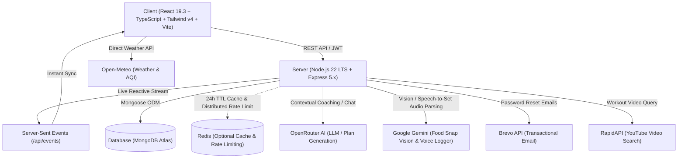
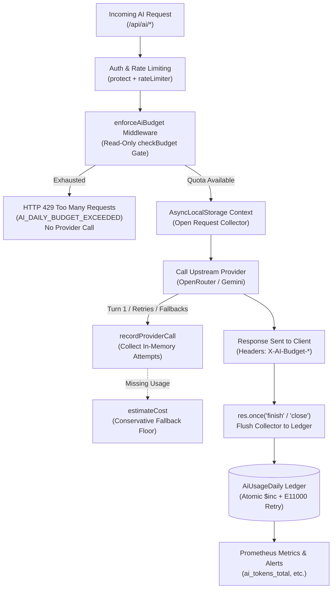

# 🏗️ Architecture & Technical Design

[← Back to Documentation Index](README.md)

> ⏱️ **Last verified against code:** 2026-10-31 (commit 8a875d2)

## 🛠️ Tech Stack



### Frontend Architecture
- **Framework:** React 19.3.1 with TypeScript ~5.9.3
- **Build Engine:** Vite 8.3.5
- **Design System:** Tailwind CSS v4.3.3
- **Routing:** React Router v7 (`react-router-dom` 7.18.4)
- **Motion & Micro-interactions:** Framer Motion 14.6.0
- **Data Charts:** Recharts 3.10.1 (with ReferenceLines, dynamic Cells, and custom tooltips)
- **Document & Data Export:** jsPDF 4.2.1 (patched DOMPurify), jsPDF-AutoTable 5.0.9, html2canvas
- **Data Modeling & Validation:** Zod 4.6.5
- **Icons:** Lucide React 1.61.0
- **Notifications:** React Hot Toast 2.6.1
- **Testing:** Vitest 5.0.5 with `@testing-library/react` and `jsdom` 30.1.3

### Backend Architecture
- **Runtime:** Node.js 22 LTS (`>=20.0.0` supported, tested on Node 20 & 22)
- **Framework:** Express.js 5.3.0
- **Database & ODM:** MongoDB & Mongoose 9.11.3
- **Security & Reliability:** Helmet 8.3.0, CORS, `express-rate-limit` 8.7.1 (dual IP and per-user limiters), bcryptjs 3.0.3, JSON Web Tokens (JWT) 9.0.2, Role-Based Admin Auth (`requireAdmin`)
- **Contract Validation:** Zod 4.6.5
- **Media Ingestion:** Multer 2.4.0 (multipart form handling for vision analysis & voice set audio)
- **Real-Time Updates:** Server-Sent Events (SSE) with ticket authentication
- **Caching & Rate Limiting:** ioredis 6.0.0 with automatic in-memory fallback
- **Logging & Tracing:** Structured JSON Logger (`LOG_LEVEL`), automated secret scrubber (passwords, tokens, API keys), request ID correlation middleware (`X-Request-Id`), and HTTP access logging
- **Health & Monitoring:** Production uptime monitoring endpoint (`GET /api/health`) with live MongoDB connection state inspection
- **Per-User Daily AI Budgets & Metering:** Request-scoped `AsyncLocalStorage` collector tracking token usage across retries, fallbacks, and repair attempts, flushing into an atomic Mongoose daily ledger (`AiUsageDaily`) on response completion.
- **External Providers:** Google Gemini API (`@google/generative-ai` 0.24.1 for Food Snap vision and voice set logging), OpenRouter (GPT-4o-mini & fallback models), Brevo HTTP API (transactional email), NewsAPI, RapidAPI

### 📊 Daily AI Budget & Usage Metering Architecture



---


## 📁 Project Structure

```text
AI-FitnessTracker1/
├── .github/
│   ├── workflows/
│   │   └── ci.yml                       # GitHub Actions CI workflow (Node 22)
│   └── dependabot.yml                   # Dependabot dependency update configuration
├── apps/                                # Monorepo application containers
│   ├── client/                          # Client workspace package
│   └── server/                          # Server workspace package
├── client/                              # React 19 + TypeScript Client
│   ├── public/
│   │   └── favicon.svg                  # Brand favicon
│   ├── src/
│   │   ├── Pages/                       # Route views
│   │   │   ├── Dashboard.tsx            # Analytics, rings, streak, water, insights
│   │   │   ├── FoodLog.tsx              # Nutrition logging, AI food snap & heatmap
│   │   │   ├── ActivityLog.tsx          # Exercise tracker & activity heatmap
│   │   │   ├── AIAssistant.tsx          # FitBot AI chat interface (React Compiler compliant)
│   │   │   ├── Workouts.tsx             # 3-tab studio (Videos / Today's Plan / Music)
│   │   │   ├── MealPlanner.tsx          # Glassmorphism meal generator (1-day & multi-day)
│   │   │   ├── ActivityPlanner.tsx      # Glassmorphism workout generator (1-day & multi-day)
│   │   │   ├── Weather.tsx              # Live forecast & AQI
│   │   │   ├── Blog.tsx / BlogPost.tsx  # Fitness articles & news feed
│   │   │   ├── Profile.tsx              # User metrics, macro targets, PDF & CSV export
│   │   │   ├── Login.tsx                # Auth form (Sign in / Sign up)
│   │   │   ├── GoogleCallback.tsx       # Secure fragment-based OAuth handler
│   │   │   ├── ForgotPassword.tsx       # Password reset request view
│   │   │   ├── ResetPassword.tsx        # Password update view
│   │   │   ├── VerifyEmail.tsx          # Email verification confirmation view
│   │   │   └── Onboarding.tsx           # Initial setup questionnaire
│   │   ├── components/
│   │   │   ├── BottomNav.tsx            # Mobile fixed bottom navigation dock
│   │   │   ├── Sidebar.tsx              # Responsive sidebar & mobile drawer
│   │   │   ├── CalendarHeatmap.tsx      # 90-day activity & nutrition heatmap
│   │   │   ├── Logo.tsx                 # Dynamic SVG animated logo
│   │   │   ├── DateDropdown.tsx         # Date selector component
│   │   │   ├── FitBotAvatar.tsx         # FitBot visual avatar
│   │   │   ├── MarkdownMessage.tsx      # Markdown parser for AI responses
│   │   │   ├── auth/                    # Auth-specific UI (PasswordStrengthMeter, etc.)
│   │   │   ├── ui/                      # Shared reusable UI primitives (BottomSheet, etc.)
│   │   │   └── animations/              # Interactive workout modals, steppers & timers
│   │   ├── features/                    # Domain-specific types & playlist definitions
│   │   ├── utils/                       # O(N) dailyTotals engine, deriveGoals
│   │   ├── test/                        # Client Vitest unit tests
│   │   ├── hooks/                       # Custom React hooks (useVideoSearch, useToday)
│   │   ├── Context/                     # AppContext & ThemeContext providers
│   │   ├── App.tsx                      # Root routes & layout wrapper
│   │   └── index.css                    # Tailwind CSS v4 theme tokens
│   ├── index.html                       # HTML entry point (viewport-fit=cover)
│   ├── vite.config.ts                   # Vite configuration
│   └── package.json                     # Client dependencies & scripts
│
├── docs/                                # Technical documentation, audits & RFCs
│   ├── ENGINEERING_REPORTS.md           # Engineering audit & architecture RFC index
│   ├── email-deliverability.md          # Brevo transactional email architecture
│   ├── monitoring-alerts.md             # Prometheus metrics & monitoring setup
│   ├── fitbot-phase-1-audit.md          # Phase 1: Fitness data model & context audit
│   ├── fitbot-phase-2-chat-reliability.md # Phase 2: Chat reliability & idempotency
│   ├── fitbot-phase-3-contracts.md      # Phase 3: Zod schemas & contract validation
│   ├── fitbot-phase-4-ai-reliability.md # Phase 4: Model fallback & transient retries
│   ├── fitbot-phase-4-contextual-coaching.md # Phase 4: Contextual fitness coaching
│   ├── fitbot-phase-5-adaptive-planners.md # Phase 5: Adaptive meal & activity planners
│   ├── fitbot-phase-6-release-readiness.md # Phase 6: Release readiness review
│   └── fitbot-phase-h-release-evidence.md # Phase H: Model evaluation & verification
│
├── packages/                            # Decoupled published libraries (@jashan-randhawa/*)
│   ├── openrouter-resilient-client/     # Resilient OpenRouter LLM client
│   ├── express-ai-guard/                # Express security & dual rate limiting
│   ├── react-calendar-heatmap-streaks/  # Contribution-style heatmap
│   ├── react-workout-tracker/           # Workout session hook & live modal
│   ├── react-motion-presets/            # Framer Motion animation presets
│   ├── fitness-utils/                   # BMR, TDEE, macros, PDF/CSV export
│   └── ai-nutrition-estimator/          # Multimodal nutrition engine
│
├── server/                              # Express 5 + MongoDB API
│   ├── server.js                        # Server entry point
│   ├── scripts/                         # Operational & maintenance utilities
│   │   ├── smoke-test.js                # Server boot & endpoint smoke test
│   │   ├── ci-guard-email.js            # Automated forbidden mail dependency scanner
│   │   ├── backfill-weightlog-localday.js # WeightLog localDay migration utility
│   │   ├── backfill-auth-methods.js     # Auth method migration utility
│   │   ├── live-model-eval.js           # Model evaluation & guardrail verification
│   │   └── test-email.js                # Brevo email verification tool
│   ├── test/                            # Unit tests (node --test)
│   └── src/
│       ├── app.js                       # Express application setup & middleware
│       ├── config/                      # Database & environment configuration
│       ├── controllers/                 # Endpoint business logic
│       ├── middleware/                  # JWT auth, rate limiters, upload, errorHandler
│       ├── models/                      # Mongoose schemas (User, Food, Activity, Water, Weight, Blog, Chat, WorkoutPlan)
│       ├── prompts/                     # Versioned AI system prompts
│       ├── routes/                      # API route definitions
│       ├── schemas/                     # Zod request & response schemas
│       ├── services/                    # AI, fitness context, planner, email & seed services
│       └── utils/                       # Structured logger, secret scrubber, Redis client
│
├── CHANGELOG.md                         # Release history (v1.0.0 through v2.6.0)
├── IMPLEMENTATION_GUIDE.md              # Technical architecture & deployment guide
└── LICENSE                              # MIT License
```

---

