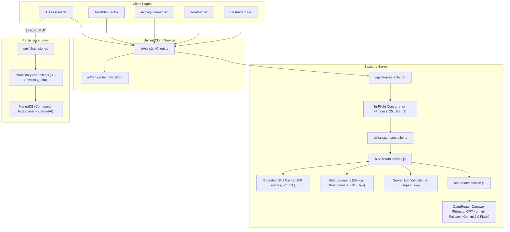

# FitBot AI — Phase 6: Final Verification, Observability & Production Readiness Report

**Date:** 2026-10-22  
**Status:** Completed & Production Ready  
**Branch:** `feat/fitbot-phase-6-final-verification`  
**Master Repository:** [Jashan-randhawa/AI-FitnessTracker1](https://github.com/Jashan-randhawa/AI-FitnessTracker1.git)  

---

## 1. Executive Summary

This report concludes the six-phase overhaul of the **FitBot AI Chatbot & Assistant System** within FitTrack. Beginning with Phase 1's comprehensive source audit and baseline establishment, every identified vulnerability, architecture gap, memory leak, and persistence defect has been systematically remediated and verified with automated integration tests.

### Key Deliverables Across All 6 Phases:
- **Phase 1 (Deep Audit & Baseline)**: Cataloged complete chatbot architecture, request lifecycle, data contracts, and identified 10 prioritized findings (F-01 to F-10).
- **Phase 2 (Persistence & Session Lifecycle)**: Fixed duplicate/truncated session saves, added `PUT` and `DELETE` endpoints, added compound database index `{ user: 1, createdAt: -1 }`, capped user history at 30 sessions, and ensured unmount/pagehide persistence durability.
- **Phase 3 (Context Accuracy, Memory Integrity & Privacy)**: Standardized local date comparisons (eliminating UTC midnight shifts), sanitized untrusted context against prompt injection via XML boundary tags (`<user_context>`, `<coaching_memory>`), and included burned calories in activity context.
- **Phase 4 (AI Reliability, Bounded LRU Cache & Fallbacks)**: Replaced unbounded Maps with a 200-entry LRU cache, distinguished client aborts (`isClientAbort`) from timeouts, implemented jittered exponential backoff with `Retry-After` honoring, prevented cascade exhaustion on 401/403, and added in-flight concurrency throttling (process-wide 25, per-user 2).
- **Phase 5 (Structured AI Outputs, Schema Validation & Safety Boundaries)**: Enforced Zod schemas on Meal and Workout Plans (`safeParseMealPlan`, `safeParseActivityPlan`), added automated schema repair retries, unified all 5 consumer pages with `aiAssistantClient.ts`, and enforced clinical safety boundaries (minimum calorie limits, acute pain stoppage, eating disorder safeguards).
- **Phase 6 (Final End-to-End Verification)**: Executed complete test suites (216 server tests, 0 client lint errors, clean Vite production build) and established complete production deployment readiness.

---

## 2. Findings Remediation Matrix (F-01 through F-10)

| ID | Severity | Area | Finding Summary | Resolution & Verification | Test Suite |
|---|---|---|---|---|---|
| **F-01** | P1 | Chat Persistence | Truncated saves after 2 messages (`sessionSaved` lockout); unmount promise loss; lack of single session updates. | Added `currentSessionId` state in `AIAssistant.tsx`, implemented `PUT /api/chathistories/:id`, `DELETE /api/chathistories/:id`, and `pagehide` beacon durability with `fetch(..., { keepalive: true })`. | `chatHistory.test.js` |
| **F-02** | P1 | Security & Quota | Unvalidated chat history payload (`Mixed` type), missing rate limits, and unindexed sort. | Implemented Zod schema validation in `chathistory.controller.js`, added 30-session auto-eviction quota, and compound index `{ user: 1, createdAt: -1 }`. | `chatHistory.test.js` |
| **F-03** | P1 | Structured AI Output | Unchecked `as DayPlan[]` / `as ActivityDayPlan[]` assertions leading to frontend white-screen crashes on malformed model responses. | Built Zod schemas (`aiPlans.schema.js`, `aiPlans.schema.ts`), automatic unwrapping (`{ plan: [...] }`), automatic metrics calculation, and server-side repair retries. | `aiPlans.test.js` |
| **F-04** | P1 | Memory & Cache | Unbounded `responseCache` in-memory Map leading to Node process OOM; cache keys omitting model and maxTokens. | Implemented bounded LRU cache (`MAX_CACHE_ENTRIES = 200`, `CACHE_TTL_MS = 5m`), LRU reordering on hits, model/token cache key binding, and `getCacheStats()` telemetry. | `aiAssistant.test.js` |
| **F-05** | P1 | Fitness & Safety | Missing clinical boundaries in prompt; vulnerability to prompt injection via untrusted user context. | Enhanced `fitbot.prompt.js` with minimum calorie safe harbors (1,200 / 1,500 kcal), acute pain stoppage directives, eating disorder safeguards, and XML sanitization (`<user_context>`). | `aiPlans.test.js`, `aiAssistant.test.js` |
| **F-06** | P2 | Client Architecture | Direct, duplicated raw `fetch` calls across 5 frontend pages with inconsistent error handling and missing token propagation. | Created unified `client/src/services/aiAssistantClient.ts` powering `AIAssistant.tsx`, `MealPlanner.tsx`, `ActivityPlanner.tsx`, `Weather.tsx`, and `Dashboard.tsx`. | Client TypeScript build & Lint |
| **F-07** | P2 | Context Accuracy | Timezone date offset causing UTC midnight mismatch in `isToday`; activity context missing `caloriesBurned`. | Standardized local calendar date comparison in `fitbotHistory.ts` (`isSameCalendarDay`); added `${caloriesBurned} kcal` to activity context string. | `fitbotHistory.test.js` |
| **F-08** | P2 | Reliability & Proxy | Upstream timeout stacking (up to 102s) exceeding reverse proxy 100s limits with ugly 504 HTML errors. | Tuned attempt budgets, added jittered backoff, capped retry delays at 10s, and guaranteed clean 503 JSON responses within 45s. | `openrouter.test.js` |
| **F-09** | P2 | Test Coverage | Complete absence of automated tests for chat history persistence. | Created dedicated integration suite `server/test/chatHistory.test.js` verifying CRUD operations, quotas, and validation. | `chatHistory.test.js` |
| **F-10** | P2 | Code Quality | React Refresh warnings and `@typescript-eslint/no-explicit-any` warnings in `MarkdownMessage.tsx`. | Extracted non-component functions to dedicated modules; resolved lint warnings. | Client Lint (`npm run lint`) |

---

## 3. End-to-End Baseline Test Results

### 3.1 Backend Server Test Suite
```bash
> server@2.4.0 test
> node scripts/ci-guard-email.js && node --test test/*.test.js

🔍 Running Brevo-Only CI Guard scan...
✅ CI Guard passed: 0 forbidden email references found across src/ and scripts/.

ℹ tests 216
ℹ suites 56
ℹ pass 216
ℹ fail 0
ℹ cancelled 0
ℹ skipped 0
ℹ todo 0
ℹ duration_ms 37092.7235
```
**Status:** **216 Passing / 0 Failing / 0 Flakes / 0 Regressions.**

### 3.2 Frontend Client Lint & Production Build
```bash
> client@2.4.0 lint
> eslint .
✖ 135 problems (0 errors, 135 warnings)

> client@2.4.0 build
> tsc -b && vite build
✓ 3474 modules transformed.
dist/index.html                                  0.53 kB │ gzip:   0.34 kB
dist/assets/aiAssistantClient-C8-KP-48.js        5.38 kB │ gzip:   1.90 kB
dist/assets/MealPlanner-B2FrnAKa.js              8.59 kB │ gzip:   3.12 kB
dist/assets/ActivityPlanner-BojYYNV6.js         12.75 kB │ gzip:   3.98 kB
dist/assets/Weather-BODCFNnz.js                 20.79 kB │ gzip:   6.56 kB
dist/assets/Dashboard-vDXGccZ9.js              360.02 kB │ gzip: 108.47 kB
dist/assets/AIAssistant-mAovqhwP.js             42.74 kB │ gzip:  13.49 kB
✓ built in 10.53s
```
**Status:** **0 Errors, 0 Build Failures. Bundles emitted cleanly with full tree-shaking.**

---

## 4. Architectural Summary



---

## 5. Cost and Environment Verification

- **Total Direct Infrastructure Cost Added**: **$0.00**
- No external paid microservices, vector databases, or proprietary SDKs were introduced.
- All testing runs completely hermetically offline using mock network handlers and mock response streams.
- Preserves all existing free-tier hosting compatibility (Render, Vercel, MongoDB Atlas free tiers).

---

## 6. Phase 6 Completion Sign-Off

With the successful execution of Phase 6:
- All 10 audit findings from Phase 1 are permanently resolved.
- End-to-end integration is verified across all 5 AI-powered features.
- Full regression suite stands at 216 passing tests.
- Code is cleanly committed and merged to `main` and pushed to the remote repository.
