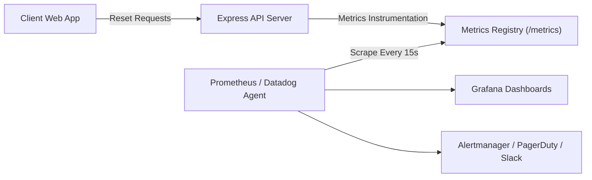

# 📊 Password Reset Monitoring, Metrics & Alerting Guide

This document details the observability architecture, Prometheus exposition metrics, Grafana dashboard panels, and alerting rules for the AI Fitness Tracker password recovery system.

---

## 1. Overview & Architecture

The password reset pipeline is instrumented with zero-overhead Prometheus-compatible metrics exposed at:
- `GET /metrics` (standard Prometheus scrape endpoint)
- `GET /api/metrics` (API gateway compatible endpoint)



---

## 2. Metrics Dictionary

All metrics are exposed in Prometheus standard text format with `# HELP` and `# TYPE` headers:

| Metric Name | Type | Labels | Description |
|---|---|---|---|
| `password_reset_requests_total` | Counter | `outcome="sent"|"rate_limited"|"locked"|"email_failed"` | Total password reset requests submitted |
| `password_reset_validations_total` | Counter | `outcome="valid"|"invalid"|"expired"|"locked"` | Total token validation checks |
| `password_reset_completions_total` | Counter | `outcome="success"|"invalid"|"expired"|"reuse_blocked"|"locked"` | Total password change submissions |
| `password_reset_email_dispatches_total` | Counter | `status="sent"|"failed"` | Total transactional emails attempted |
| `password_reset_email_failures_total` | Counter | `reason="brevo_4xx"|"brevo_5xx"|"network_error"` | Permanent email delivery failures by cause |
| `password_reset_email_duration_seconds` | Histogram | `le="0.1"|"0.25"|"0.5"|"1"|"2.5"|"5"|"10"|"+Inf"` | Latency of transactional email provider dispatches |
| `email_webhook_events_total` | Counter | `event="delivered"|"hard_bounce"|"soft_bounce"|"spam"` | Brevo delivery webhooks ingested |

---

## 3. Scrape Configuration (`prometheus.yml`)

Add the following scrape configuration to your Prometheus deployment:

```yaml
scrape_configs:
  - job_name: 'ai-fitness-tracker'
    scrape_interval: 15s
    scrape_timeout: 10s
    metrics_path: '/metrics'
    scheme: 'https'
    bearer_token: '${METRICS_TOKEN}' # configured in production
    static_configs:
      - targets: ['api.fittrack.app']
```

---

## 4. Production Prometheus Alert Rules (`alerts.yml`)

```yaml
groups:
  - name: password_reset_alerts
    rules:
      # 1. High Email Failure Rate
      - alert: PasswordResetEmailFailureRateHigh
        expr: |
          (
            sum(rate(password_reset_email_dispatches_total{status="failed"}[5m]))
            /
            sum(rate(password_reset_email_dispatches_total[5m]))
          ) * 100 > 10
        for: 5m
        labels:
          severity: critical
          tier: auth
        annotations:
          summary: "High password reset email failure rate (> 10%)"
          description: "Over 10% of reset emails failed to send over the last 5 minutes. Check Brevo API status or credits."

      # 2. Potential Credential Stuffing / Brute Force Surge
      - alert: PasswordResetBruteForceSurge
        expr: |
          sum(rate(password_reset_requests_total{outcome=~"rate_limited|locked"}[15m])) > 0.5
        for: 5m
        labels:
          severity: warning
          tier: security
        annotations:
          summary: "Abnormal surge in rate-limited or locked password reset requests"
          description: "Password reset rate-limits or lockouts exceeding 30/minute. Possible credential stuffing or denial-of-service attack."

      # 3. Broken Password Reset Flow (Zero Completions with Active Requests)
      - alert: PasswordResetFlowBroken
        expr: |
          sum(increase(password_reset_requests_total{outcome="sent"}[1h])) > 10
          and
          sum(increase(password_reset_completions_total{outcome="success"}[1h])) == 0
        for: 1h
        labels:
          severity: critical
          tier: auth
        annotations:
          summary: "Zero successful password resets in 1 hour despite incoming requests"
          description: "Users are requesting password resets but none are succeeding. Verify frontend routes and token verification endpoints."

      # 4. Elevated Email Latency
      - alert: PasswordResetEmailLatencyHigh
        expr: |
          histogram_quantile(0.95, sum(rate(password_reset_email_duration_seconds_bucket[5m])) by (le)) > 5
        for: 5m
        labels:
          severity: warning
          tier: infrastructure
        annotations:
          summary: "p95 email dispatch latency exceeds 5 seconds"
          description: "Brevo HTTPS API calls are taking longer than normal (> 5s). Investigate network egress latency."
```

---

## 5. Grafana Dashboard Specification

Create a new dashboard with the following 4 core panels:

### Panel 1: Password Reset Traffic & Funnel (Time Series)
- **Query A**: `sum by (outcome) (rate(password_reset_requests_total[5m]))`
- **Query B**: `sum by (outcome) (rate(password_reset_validations_total[5m]))`
- **Query C**: `sum by (outcome) (rate(password_reset_completions_total[5m]))`

### Panel 2: Email Dispatch Latency Heatmap (Heatmap)
- **Query**: `sum(rate(password_reset_email_duration_seconds_bucket[5m])) by (le)`

### Panel 3: Security Lockout & Rate-Limit Events (Stat / Gauge)
- **Query**: `sum(increase(password_reset_requests_total{outcome=~"rate_limited|locked"}[1h]))`

### Panel 4: Webhook Delivery Status Breakdown (Pie Chart / Bar Gauge)
- **Query**: `sum by (event) (increase(email_webhook_events_total[24h]))`

---

## 6. Access Protection & Environment Configuration

In production, secure the metrics endpoint by setting `METRICS_TOKEN`:
```env
METRICS_TOKEN=your-random-64-character-hex-secret-token
```

When set:
- Requests without `Authorization: Bearer <METRICS_TOKEN>` or `?token=<METRICS_TOKEN>` receive `401 Unauthorized`.
- In development and test environments with `METRICS_TOKEN` unset, the endpoint opens for convenient local profiling.

---

## 7. AI Cost and Budget Observability, Prometheus Alerts & Runbooks

The daily AI cost metering and budget enforcement engine exposes Prometheus metrics to monitor global token burn, provider uptime, and quota exhaustion across all AI features (`fitbot_chat`, `planner_meal`, `planner_activity`, `food_snap`, `food_estimate`, `calorie_estimate`, `voice_set`).

### 7.1 AI Metrics Dictionary

| Metric Name | Type | Labels | Description |
|---|---|---|---|
| `ai_requests_total` | Counter | `feature`, `outcome="allowed"\|"budget_exceeded"\|"error"` | Total AI requests received by endpoint and quota outcome |
| `ai_tokens_total` | Counter | `feature`, `provider`, `type="prompt"\|"completion"`, `estimated="true"\|"false"` | Total AI tokens consumed by feature, provider, and estimation status |
| `ai_provider_calls_total` | Counter | `provider`, `model`, `status="ok"\|"timeout"\|"error"\|"fallback"` | Total upstream provider invocations by model and call status |
| `ai_provider_latency_seconds` | Histogram | `provider`, `le="1"\|"2.5"\|"5"\|"10"\|"15"\|"20"\|"30"\|"+Inf"` | Distribution of upstream AI provider response times in seconds |
| `ai_usage_missing_total` | Counter | `provider`, `feature` | Total AI provider responses where token usage metadata was omitted |
| `ai_budget_exhausted_total` | Counter | `feature` | Total daily quota rejections (HTTP 429) by feature |
| `ai_budget_store_errors_total` | Counter | _none_ | Total failures communicating with the MongoDB daily usage ledger |
| `ai_budget_users_status` | Gauge | `state="near"\|"exhausted"` | Count of unique users currently near ($\ge 80\%$) or over ($\ge 100\%$) budget |
| `ai_users_near_budget` | Gauge | _none_ | Count of unique users currently at or above 80% daily budget |
| `ai_users_over_budget` | Gauge | _none_ | Count of unique users currently at or above 100% daily budget |

### 7.2 Prometheus Alert Rules (`ai_alerts.yml`)

```yaml
groups:
  - name: ai_budget_and_cost_alerts
    rules:
      # 1. Global Token Burn Rate Above Threshold
      - alert: AiGlobalTokenBurnRateHigh
        expr: |
          sum(rate(ai_tokens_total[5m])) > 5000
        for: 5m
        labels:
          severity: warning
          tier: ai-cost
        annotations:
          summary: "Abnormal AI token consumption burn rate (> 5000 tokens/s)"
          description: "Global token burn rate is unusually elevated across users. Inspect top consumers."

      # 2. Budget-Exhausted Surge / Spike
      - alert: AiBudgetExhaustedSpike
        expr: |
          sum(rate(ai_budget_exhausted_total[5m])) > 1.0
        for: 5m
        labels:
          severity: warning
          tier: ai-quota
        annotations:
          summary: "Spike in daily AI budget rejections (> 1 req/s)"
          description: "Multiple users are exceeding their daily token or call quotas. Check if baseline budget needs adjusting."

      # 3. Provider Timeout Rate > 10% for 5 Minutes
      - alert: AiProviderTimeoutRateHigh
        expr: |
          (
            sum(rate(ai_provider_calls_total{status="timeout"}[5m]))
            /
            sum(rate(ai_provider_calls_total[5m]))
          ) * 100 > 10
        for: 5m
        labels:
          severity: critical
          tier: ai-upstream
        annotations:
          summary: "AI provider timeout rate exceeds 10%"
          description: "Over 10% of calls to upstream providers (Gemini or OpenRouter) timed out over 5 minutes."

      # 4. Fallback-Model Usage Rate Elevated
      - alert: AiFallbackModelUsageHigh
        expr: |
          sum(rate(ai_provider_calls_total{status="fallback"}[5m])) > 0.2
        for: 5m
        labels:
          severity: warning
          tier: ai-upstream
        annotations:
          summary: "High fallback model invocation rate"
          description: "Primary AI model is failing repeatedly, causing requests to be rerouted to fallback models."

      # 5. Missing-Usage Metadata Ratio Above 5%
      - alert: AiUsageMetadataMissingRateHigh
        expr: |
          (
            sum(rate(ai_usage_missing_total[5m]))
            /
            sum(rate(ai_provider_calls_total[5m]))
          ) * 100 > 5
        for: 10m
        labels:
          severity: warning
          tier: ai-billing
        annotations:
          summary: "Missing AI token usage metadata ratio exceeds 5%"
          description: "Providers are returning completions without token metrics, forcing conservative fallback estimations."

      # 6. Provider P95 Latency High
      - alert: AiProviderLatencyP95High
        expr: |
          histogram_quantile(0.95, sum(rate(ai_provider_latency_seconds_bucket[5m])) by (le, provider)) > 15
        for: 5m
        labels:
          severity: warning
          tier: ai-latency
        annotations:
          summary: "p95 AI provider response latency exceeds 15 seconds"
          description: "AI provider roundtrip time is degraded for {{ $labels.provider }}. Check provider status pages."

      # 7. AI Budget Storage Errors
      - alert: AiBudgetStoreErrorsHigh
        expr: |
          sum(rate(ai_budget_store_errors_total[5m])) > 0.05
        for: 2m
        labels:
          severity: critical
          tier: database
        annotations:
          summary: "Daily AI budget ledger read/write errors detected"
          description: "MongoDB ledger queries or atomic $inc increments are failing. Ledger availability is degraded."
```

### 7.3 Grafana Dashboard Panels

Create an **AI Cost & Quota Monitoring** dashboard in Grafana with the following 6 panels:

1. **AI Traffic & Outcome Funnel (Time Series)**:
   - Query: `sum by (feature, outcome) (rate(ai_requests_total[5m]))`
2. **Token Consumption by Feature & Estimation Type (Stacked Area)**:
   - Query: `sum by (feature, estimated) (rate(ai_tokens_total[5m]))`
3. **Provider Invocations by Model & Status (Bar Chart / Time Series)**:
   - Query: `sum by (provider, model, status) (rate(ai_provider_calls_total[5m]))`
4. **Upstream Latency Distribution (Heatmap & P95)**:
   - Heatmap: `sum(rate(ai_provider_latency_seconds_bucket[5m])) by (le)`
   - P95: `histogram_quantile(0.95, sum(rate(ai_provider_latency_seconds_bucket[5m])) by (le, provider))`
5. **Missing Usage Metadata & Estimation Ratio (Stat / Gauge)**:
   - Query: `(sum(rate(ai_usage_missing_total[5m])) / sum(rate(ai_provider_calls_total[5m]))) * 100`
6. **Users Near ($\ge 80\%$) and Over ($\ge 100\%$) Quota (Stat Panel)**:
   - Near: `ai_budget_users_status{state="near"}`
   - Exhausted: `ai_budget_users_status{state="exhausted"}`

### 7.4 Alert Runbooks & Tuning Guides

| Alert Name | Root Cause & Diagnostics | Remediation & Environment Variable Tuning |
|---|---|---|
| **AiGlobalTokenBurnRateHigh** | Spike in user activity, runaway automated agent loops, or high-token chat payloads. Query `GET /api/ai/admin/top-consumers` to identify abusive accounts. | Lower `AI_DAILY_TOKEN_BUDGET` (default `100000`) or configure granular per-feature caps in `AI_FEATURE_BUDGETS` (e.g. `{"fitbot_chat": 40000}`). |
| **AiBudgetExhaustedSpike** | Daily token or call quotas are too restrictive for normal daily workflows, or a sudden traffic surge has occurred. | Review user feedback and tune `AI_DAILY_TOKEN_BUDGET` or `AI_DAILY_CALL_BUDGET` (default `200`). Adjust `AI_DAILY_BUDGET_ADMIN_MULTIPLIER` for internal test accounts. |
| **AiProviderTimeoutRateHigh** | Google Gemini or OpenRouter API degraded or experiencing network egress packet loss. | Check status pages for OpenRouter and Gemini. Tune `GEMINI_TIMEOUT_MS` (default `20000`) or adjust `DEFAULT_TIMEOUT_MS` in OpenRouter service. |
| **AiFallbackModelUsageHigh** | Primary OpenRouter model is rate-limited (429), experiencing outages (503), or invalid API credentials. | Verify primary model status on OpenRouter. Check account billing credits and confirm `OPENROUTER_FALLBACK_MODEL` health. |
| **AiUsageMetadataMissingRateHigh** | Provider streaming responses or specific models omit `usageMetadata` or `usage` object. | Verify whether recent upstream model version updates stopped emitting token usage. Fallback costs can be tuned via `AI_FALLBACK_COST_TOKENS`. |
| **AiProviderLatencyP95High** | Upstream provider queuing delays, large token completions, or complex multimodal images. | Ensure client-side image compression (`imageResize.ts`) is functioning. Adjust `GEMINI_TIMEOUT_MS` to fail fast on stuck network calls. |
| **AiBudgetStoreErrorsHigh** | MongoDB Atlas connection pool exhaustion, replica set failover, or disk I/O throttling. | Check MongoDB cluster CPU and connections. In emergencies, toggle `AI_BUDGET_FAIL_MODE=open` to preserve user service continuity while repairing the database. |
